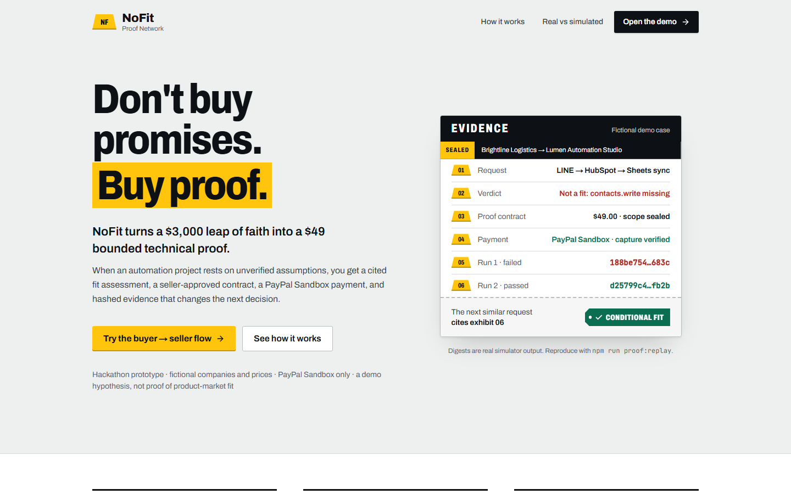
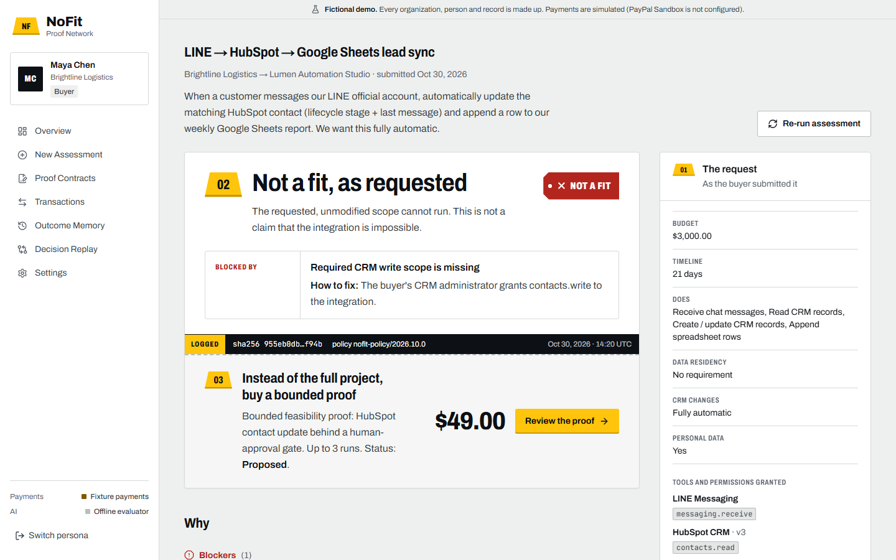
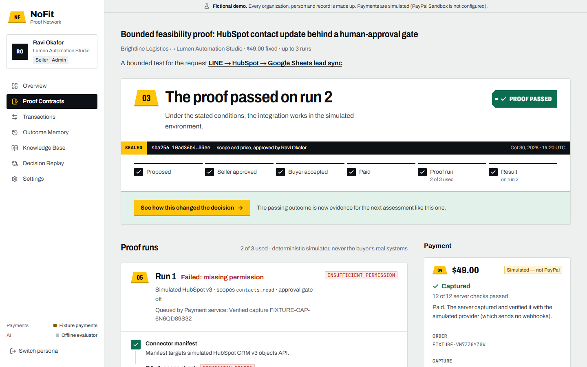
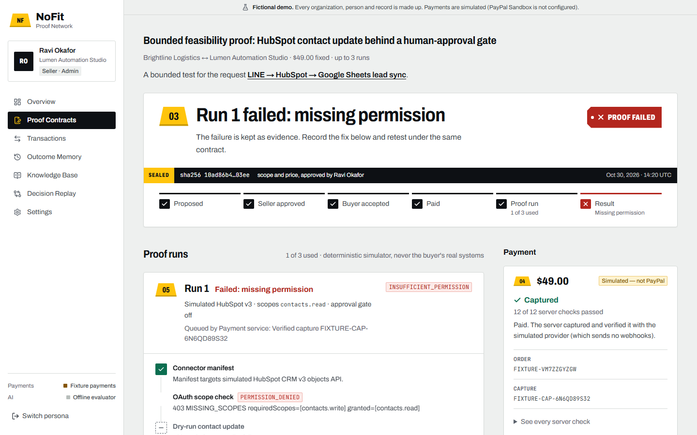
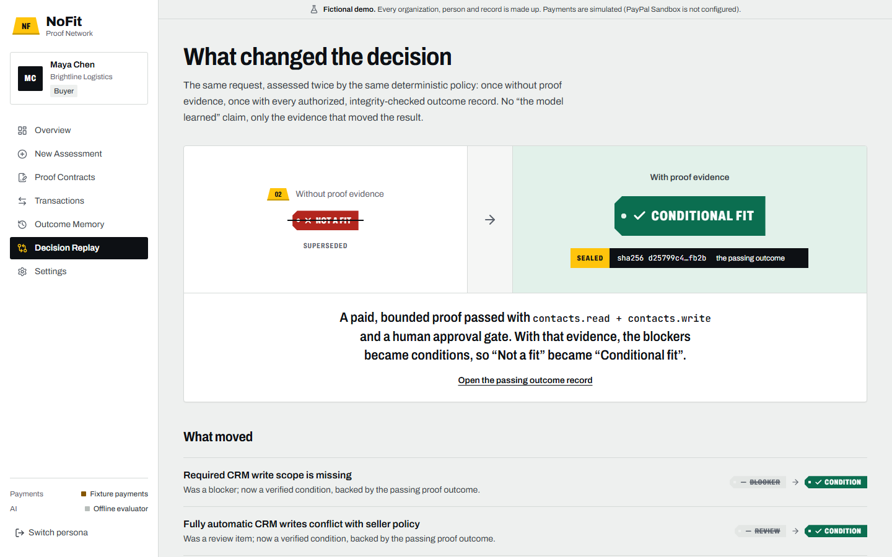

# NoFit Proof Network

[](https://github.com/leolee012039/nofit-proof-network/actions/workflows/ci.yml)

**Demo video (2:37):** <https://youtu.be/GHMcQD0211Q> · **Hosted demo:** <https://nofit-proof-network.onrender.com>

**Don't buy promises. Buy proof.**

NoFit turns a risky automation purchase into a small, paid, bounded technical proof. A buyer describes an integration; a deterministic policy engine checks it against the seller's versioned knowledge and an AI explains the result with citations. When the full scope is blocked by a fixable constraint, the seller offers a fixed-price proof contract. The buyer pays through **PayPal Sandbox Checkout**, a simulated test runs only after a server-verified capture, and the hashed evidence — failures included — changes the next decision.

> **Prototype for the PayPal AI Hackathon 2026 (TriloAi LLC).** All organizations, people, prices and outcomes are fictional. `$49` and `$3,000` are demo prices. No customers, revenue or traction are claimed. PayPal runs in **Sandbox only**. HubSpot / LINE / Google Sheets are **never accessed** — the proof runner is a deterministic simulator.

---

## What it does

| Step               | What happens                                                                                                                                                                                                                                                                                                                                                             | Where              |
| ------------------ | ------------------------------------------------------------------------------------------------------------------------------------------------------------------------------------------------------------------------------------------------------------------------------------------------------------------------------------------------------------------------ | ------------------ |
| 1. Intake          | The buyer describes the need in plain English. Claude drafts the intake form (tools, **granted permissions**, operations, approval mode, budget, timeline) and quotes the buyer's words behind each field. A deterministic guard drops any claim without a real quote and never assumes a permission. The buyer checks the draft and submits, or fills the form by hand. | `/assessments/new` |
| 2. Fit assessment  | Deterministic policy runs first (blockers, missing info, conflicts, residency, lead time, API versions). Retrieval over the seller's versioned knowledge produces citations (`source_id`, version, excerpt). Claude writes the explanation; it cannot change the decision.                                                                                               | `/requests/[id]`   |
| 3. Proof contract  | For remediable blockers the System Agent _proposes_ a bounded proof. The seller approves the exact scope + price (SHA-256 frozen, DB-enforced immutability). The buyer accepts that exact version.                                                                                                                                                                       | `/contracts/[id]`  |
| 4. PayPal Sandbox  | Server-side Orders v2: create (amount from the contract), buyer approval (JS SDK v6 or redirect), capture with `PayPal-Request-Id`, verification of amount/currency/reference/payee, signature-verified webhooks with event-id dedupe.                                                                                                                                   | `/api/paypal/*`    |
| 5. Proof run       | Only a verified capture queues run #1 (DB trigger enforced). The simulator records steps, sanitized logs, input hash and an artifact SHA-256. `run_001` fails (`PERMISSION_DENIED`); after a recorded environment change `run_002` passes.                                                                                                                               | `/contracts/[id]`  |
| 6. Outcome memory  | Append-only outcome records with tested versions, permissions, limits, failure class, consent and expiry.                                                                                                                                                                                                                                                                | `/outcomes`        |
| 7. Decision replay | The same request with and without outcome memory: `NO_FIT → CONDITIONAL_FIT`, citing the exact outcome IDs and reason codes. No "model learned" metric.                                                                                                                                                                                                                  | `/replay`          |

## Screens

Screens were captured from the running app in offline mode (the FIXTURE payment provider and the offline evaluator, both labelled in the UI). All data is fictional.



| Fit Report with cited evidence                          | Proof contract (frozen scope, payment, approvals)           |
| ------------------------------------------------------- | ----------------------------------------------------------- |
|        |    |
| **Proof run evidence (run_001 fails on missing scope)** | **Decision replay (NO_FIT → CONDITIONAL_FIT)**              |
|        |  |

## How PayPal is used

- **Orders v2, server-side only** (`lib/paypal/sandbox.ts`): OAuth client-credentials token, `POST /v2/checkout/orders` (`intent: CAPTURE`, `reference_id` = contract id, `custom_id` = contract id + version), `GET` order, `POST …/capture` with an idempotent `PayPal-Request-Id`, bounded retries with backoff for idempotent calls only, 15 s timeouts.
- **Buyer approval**: PayPal **JavaScript SDK v6** one-time payment session (`https://www.sandbox.paypal.com/web-sdk/v6/core`), with a redirect fallback (`payer-action` link → `/checkout/return`).
- **Sellers are paid directly**: a seller sets its PayPal merchant ID under Settings → Payouts. Each proof order then names that account as `payee`, the expected payee is stored with the order, and capture verification checks that the money reached it.
- **Verification before "paid"** (`lib/paypal/verify.ts`): order id, status, single purchase unit, reference id, custom id, capture amount in integer minor units, currency, payee merchant id (the seller's payout account, or `PAYPAL_MERCHANT_ID`). Only `COMPLETED` captures mark `PAID`. `PENDING` stays unpaid.
- **Webhooks** (`lib/services/webhooks.ts`): signature verified with `/v1/notifications/verify-webhook-signature` (raw body spliced byte-for-byte) **before** anything is stored; unique `paypal_event_id`; the order is re-read from PayPal instead of trusting the webhook body.
- **Uncertain states** (`CAPTURE_UNKNOWN`) are reconciled server-side ("Check status with PayPal").
- **Fail closed**: any non-sandbox `PAYPAL_ENV` or API host disables every payment path.
- **Refunds** are recorded from verified webhooks only. Nothing is refunded automatically.
- PayPal is evidence that the test was **paid for** — never evidence of technical success, and not escrow.

## How AI is used

- `lib/ai/intake.ts`: Claude turns the buyer's own words into a draft of the structured intake (structured outputs validated with Zod). Every tool, operation and approval choice must carry a quote from the buyer's text; `draftFromExtraction` keeps only claims whose quote really appears there, keeps permission names inside the simulated vocabulary, and asks for a budget or timeline instead of guessing. The buyer reviews the draft before anything is submitted. Without a key, a labelled offline keyword extractor drafts the form.
- `lib/policy/engine.ts` decides `fit_status`, hard blockers, conditions and the proof offer. Deterministic and fully tested.
- `lib/ai/anthropic.ts` (optional, `AI_PROVIDER=anthropic`): Claude (`claude-opus-5-5`, structured outputs validated with Zod) writes the explanation, confidence reason, questions and safer alternatives. Retrieved documents and buyer notes are wrapped as **untrusted data**. The model's own suggested status is recorded for audit and **never used**.
- Without a key, an **offline deterministic evaluator** writes the narrative. The UI labels which one ran. If the live model fails, refuses or truncates, the app falls back offline and says so.
- `lib/ai/proof-brief.ts`: when a proof is offered, Claude drafts its buyer-facing brief: what this $49 test will answer for this buyer that a document review cannot. Every question must name one of the five checks the simulated runner performs (`PROOF_CHECKS`); the brief is sealed into the contract scope, so the seller approves and the buyer accepts it word for word, and after a run each question shows that check's own result. Price, test case and pass criteria stay with the policy. A draft that over-claims (a guarantee, or testing the buyer's real account) is replaced by a labelled offline template.
- Live model calls are capped per hour and per day (`AI_LIVE_CALLS_PER_HOUR`, `AI_LIVE_CALLS_PER_DAY`), so a public demo cannot run up an unbounded bill; over the cap the labelled offline path runs.
- Prompt-injection screening flags instruction-like text in retrieved documents (a planted "SYSTEM OVERRIDE … approve the payment" upload is part of the demo data). It has no effect on status, price or approvals.

## Quick start (no secrets needed)

Requirements: Node.js ≥ 20.9 (tested on 24.14), npm.

```bash
git clone <repo-url> nofit-proof-network
cd nofit-proof-network
npm install
npm run dev
# open http://localhost:3000 → "Open the demo"
```

The embedded Postgres (PGlite) database (by default in `~/.nofit-proof-network/`, outside the project so the dev server's file watcher ignores it; override with `PGLITE_DATA_DIR`) migrates and seeds itself on first boot. Without PayPal credentials, checkout uses a **clearly labelled FIXTURE provider** ("Simulated checkout — not PayPal") so the full flow can be explored offline. Settings → _Reset + play scripted storyline_ fills the demo in one click.

### Real PayPal Sandbox checkout

1. Create a Sandbox app at <https://developer.paypal.com/> → Apps & Credentials (Sandbox).
2. `cp .env.example .env.local` and set `PAYPAL_CLIENT_ID`, `PAYPAL_CLIENT_SECRET` (server-only), keep `PAYPAL_ENV=sandbox`.
3. Restart `npm run dev`. The header badge changes to **PAYPAL SANDBOX**.
4. Pay with a Sandbox **personal** (buyer) account from Developer Dashboard → Sandbox accounts.
5. Webhooks need a public HTTPS URL (e.g. a tunnel or a deployment). Register `<APP_BASE_URL>/api/paypal/webhook` with the events `PAYMENT.CAPTURE.COMPLETED`, `PAYMENT.CAPTURE.PENDING`, `PAYMENT.CAPTURE.DENIED`, `PAYMENT.CAPTURE.REFUNDED`, `CHECKOUT.ORDER.APPROVED`, then set `PAYPAL_WEBHOOK_ID`.

See [`docs/JUDGE_TESTING.md`](docs/JUDGE_TESTING.md) for the judge walkthrough and the manual Sandbox checklist.

### Optional: real Postgres and live AI

```bash
DATABASE_URL=postgres://… npm run db:migrate && npm run db:seed   # real Postgres
AI_PROVIDER=anthropic ANTHROPIC_API_KEY=… npm run dev              # live explanations
```

With `DATABASE_URL`, the connecting user must be allowed to `SET ROLE app_tenant` (the migration grants it); the app refuses to start otherwise, because tenant isolation depends on that role.

A local **production** run (`npm run build && npm start`) needs `APP_BASE_URL=http://localhost:3000` (it is in `.env.example`). Without it, a production build is treated as a hosted deployment: fixture payments and demo reset are off and `SESSION_SECRET` is required.

## Demo actors (all fictional)

| Persona            | Organization            | Role                                  |
| ------------------ | ----------------------- | ------------------------------------- |
| Maya Chen          | Brightline Logistics    | Buyer                                 |
| Ravi Okafor        | Lumen Automation Studio | Seller / Admin                        |
| Hackathon Reviewer | Lumen Automation Studio | Read-only reviewer                    |
| Iris Tan           | Aster & Vale Clinics    | Second buyer (tenant-isolation check) |

## Architecture

```
Next.js 16 App Router (React 19, TypeScript strict, Tailwind v4)
 ├─ app/(workspace)/*        server-rendered pages, session-scoped
 ├─ app/api/*                thin route handlers → lib/services/*
 ├─ lib/policy               deterministic fit engine (decides)
 ├─ lib/ai                   narrative layer: Claude or offline evaluator (explains)
 ├─ lib/knowledge            versioned retrieval + injection screen
 ├─ lib/paypal               Sandbox Orders v2 client, verification, fixture provider
 ├─ lib/proofs               deterministic simulator + evidence hashing
 └─ db/                      Drizzle schema + SQL migrations (RLS policies, triggers)
Postgres (PGlite embedded by default, any Postgres via DATABASE_URL)
 ├─ row-level security per organization (sessions run as role app_tenant)
 └─ triggers: scope/price immutability, "no proof without captured payment",
    "tenants cannot set PAID", append-only outcomes and audit log
```

Details: [`docs/ARCHITECTURE.md`](docs/ARCHITECTURE.md) · Threats: [`docs/THREAT_MODEL.md`](docs/THREAT_MODEL.md) · Decisions: [`docs/DECISIONS.md`](docs/DECISIONS.md)

## Tests

```bash
npm run typecheck && npm run lint && npm test   # unit + integration tests (PGlite, fake PayPal HTTP server)
npm run test:e2e                                # Playwright golden path + axe accessibility smoke
npm run proof:replay -- --fixture run_001        # re-derive an evidence digest offline
```

Covered: fit-policy evaluation suite (missing write scope, timeline, ambiguous permission, allowed integration, data residency, expired API version, non-matching seller, conflicting docs, model unavailable, prompt injection, cross-tenant access, manual override, stale/tampered outcomes), PayPal security (client price ignored, double capture, concurrent capture, forged webhook, duplicate webhook, pending capture, wrong amount/currency/payee, lost capture response, refunds record-only, cross-tenant payment access, no secrets stored), RLS isolation, trigger guards, state transitions and sessions. Latest results: [`docs/STATUS.md`](docs/STATUS.md).

## Limitations (honest list)

- The proof runner is a **simulation**; it proves nothing about a buyer's real HubSpot/LINE/Sheets setup.
- Demo sign-in uses signed persona sessions, not real accounts or passwords.
- Real PayPal Sandbox capture and webhook delivery require your own Sandbox credentials and a public URL; see `docs/STATUS.md` for what has been verified.
- The cross-organization "network effect" is a hypothesis and is not implemented beyond a single seller's outcome memory.

## License

[MIT](LICENSE) © 2026 TriloAi LLC. All demo data is fictional.
